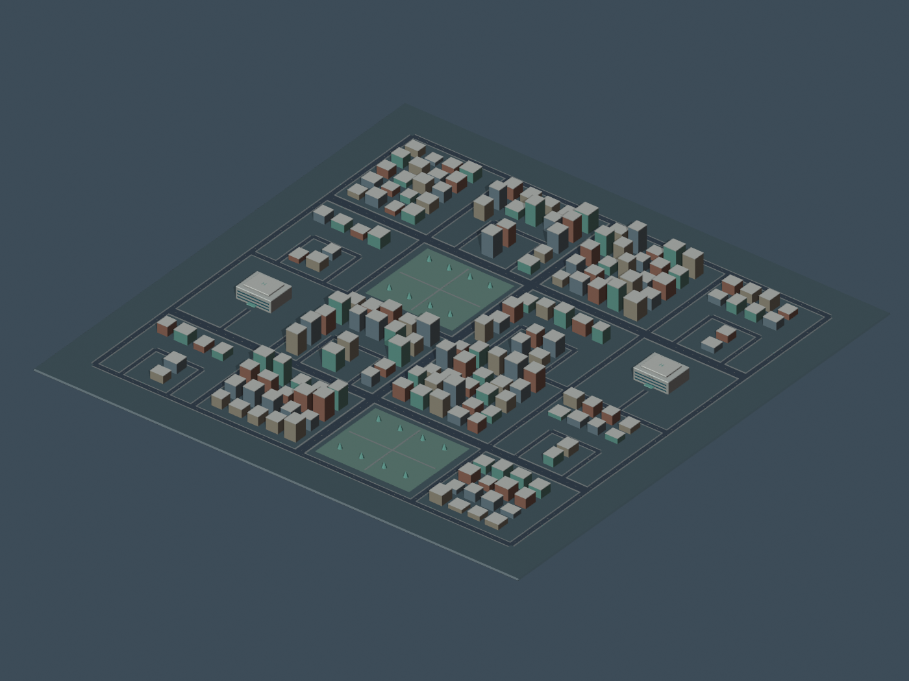

# AFTERLIGHT

**Clear the ambulance’s path. Then clear the congestion left behind.**

A Python-first AI traffic-signal prototype under active validation for Neural Storm 2026, FT-01 Smart Traffic Signal Optimisation. AFTERLIGHT compares emergency clearance policies within a canonical 25-primary-junction city, beginning with a three-intersection correctness corridor and makes both the ambulance benefit and civilian aftermath visible.

> **Status: desktop and fixture correctness gates passed; city traffic remains open.** At `11be524`, Omen passed 500 Python checks (four skips), 85 Node checks, the desktop suites and static network qualification. Fresh fixed-priority and ordinary/ordinary fixture pairs qualified with complete civilian accounting and no collisions or teleports. The sparse-city run lost its test connection; its outcome is unknown until the saved process/journal is inspected. No accepted city replay, pilot, trained model or measured improvement is claimed. The public recording catalog remains empty. See the [exact acceptance log](docs/validation/OMEN_LOG.md).

## Why Afterlight stands out

A basic emergency-priority demo turns a light green and celebrates the ambulance arriving sooner. **AFTERLIGHT tells the harder, more impressive story: prepare the corridor before arrival, then reveal what that decision leaves behind.** A compact city becomes an architectural miniature with two synchronized futures: the same external traffic demand, different signal decisions, and an aftermath you can inspect rather than take on trust.

- **Predictive pre-clearance, not a cosmetic green wave.** A Python model is designed to learn where an analytical estimate is wrong and choose a clearance lead from observed conditions.
- **The city matters after the ambulance passes.** Civilian queues, insertion backlog and recovery remain visible. A faster emergency journey is not automatically a better overall decision.
- **Evidence built into the experience.** Paired traces, a no-learning ablation, a validation-tuned fixed lead and held-out scenarios are part of the product—not a results slide added at the end.
- **A ghost that makes the counterfactual immediate.** A light-blue translucent baseline ambulance shares the same simulation clock but comes from a separate ordinary-signal world. Only the solid AFTERLIGHT ambulance affects the visible AFTERLIGHT traffic; the ghost never changes it.
- **A distinctive visual instrument.** Original Blender-authored streets, a clearly readable ambulance and synchronized camera choreography make the experiment compelling without hiding its mechanics.
- **A serious zero-paid-backend delivery plan.** The real simulator runs locally; a free public viewer exposes versioned experiment replays, provenance and results without pretending recorded data is live.

Emergency preemption itself is established work. Our intended distinction is the combination of learned timing, explicit civilian aftermath and an inspectable visual experiment. **These are design advantages we are building toward, not measured superiority claims.** Learning must beat strong non-learned alternatives on held-out decisions to earn a performance claim.

## Intended deliverable

- Python/SUMO experiment with a 25-primary-junction canonical city, two hospitals and approximately 100 pickup locations, with a three-intersection fixed-route correctness fixture.
- Learned timing selector compared with strong non-learned baselines on unseen whole scenarios.
- Original low-poly Blender-authored city assets: multicolored cuboid buildings, simple cars/trucks/bikes and a more detailed stylized ambulance; React/Three.js experiment viewer.
- Free static public replay viewer, plus local simulation and a compelling recorded demo.
- Reproducible benchmark manifests, raw outcomes, honest limitations, and setup instructions.

## Read the plan

1. [Product and contest requirements](docs/REQUIREMENTS.md)
2. [Architecture and contracts](docs/ARCHITECTURE.md)
3. [Benchmark protocol](docs/BENCHMARK_PROTOCOL.md)
4. [Visual identity](DESIGN.md) and [Blender production pipeline](docs/BLENDER_PIPELINE.md)
5. [Viewer behavior and demo](docs/VIEWER_AND_DEMO.md)
6. [Zero-cost delivery](docs/DEPLOYMENT.md)
7. [Research sources](docs/SOURCES.md) and [three-pass review record](docs/REVIEW_LOG.md)
8. [Current execution roadmap](docs/ROADMAP.md)

Three documentation passes, the final implementation review and original asset prototype are complete. Source implementation is underway; [checkpoint status](docs/IMPLEMENTATION_STATUS.md) separates implemented code from actual local acceptance. Submission still requires verified setup, actual screenshots/results, exact team attribution, licensing and AI-assistance review.

## Development entry points

The public repository is the source of truth. Source commands below are **pending
Omen acceptance** unless an exact execution result is recorded in the checkpoint log.

```sh
# Original-city viewer; no simulation or fictional results are generated here.
cd web
npm ci
npm run dev
```

The viewer loads the original Blender city and canonical pickup/hospital map.
When genuine recordings are published, it enables synchronized paired playback.
An empty catalog is intentional, not a synthetic demonstration.

For Python 3.12 setup, unit checks and local API instructions see
[implementation status](docs/IMPLEMENTATION_STATUS.md),
[replay contract](docs/REPLAY_SCHEMA.md) and [web acceptance matrix](web/README.md).
All tests, traffic experiments and browser/performance checks run on the owner's
Omen computer; cloud compilation is development evidence only.

### Dependency-free browser acceptance preview

A [source-bound compiled application preview](preview/README.md) is committed for
Omen browser QA when npm installation is unavailable. From the repository root,
run `python scripts/serve_preview.py`; it verifies its source/output/asset hashes
and serves only on loopback. This is the actual application build, not simulated
traffic, a package cache, or a substitute for reproducible source installation.
The static entry keeps the empty genuine-recording catalog; `/local.html` targets
the separately started local API. See the preview manifest for the exact compiled
source revision and the acceptance log for executed test results.

## Boundaries

Simulation research, not a real-world traffic control system. No safety certification, real emergency deployment, or lives-saved claim. No paid services or secret-bearing files are required by the design. Public replay is explicitly recorded, not disguised as live inference.

## AI-assistance disclosure

ChatGPT assisted with research, architectural planning, documentation, critical review, procedural asset creation through Blender 4.3.2 and the existing Blender MCP bridge, and implementation of Python/TypeScript source and tests. Original geometry, source scenes, generation scripts and export checks are included. A trained model or traffic benefit is not claimed merely because model-training code exists. Human review remains responsible for factual accuracy, licensing and submission compliance.

## Expanded city and fair comparison

The published map has 25 primary junctions plus 32 access/bend/terminal nodes, two hospitals and 100 curb pickup anchors. These are a world/route-selection target, **not proof of 100 trained routes or city-wide model generalization**. The three-junction corridor remains the initial correctness fixture before city scaling. Traffic is seeded and randomized; whole demand realizations, seeds and appropriate route/regime groups are held out. Randomness alone does not establish freedom from overfitting.

The ghost is a counterfactual overlay, not a second emergency vehicle in the active world. Its independent baseline queues/signals may differ, so apparent crossings through visible AFTERLIGHT cars or red lights must be explained with a label and optional separate-world view—not cosmetically corrected. See [the updated contracts](docs/ARCHITECTURE.md).

## Original assets and current 3D city

The original nine-GLB pack remains preserved: **1,268,584 bytes**, including the
14,552-triangle city prototype and 2,378-triangle ambulance. Its Khronos checks
passed with zero errors/warnings. These counts describe the original pack, not
the current enhanced city.

The current [V3 city manifest](assets/exports/city_enhanced_manifest.json) records
**4,439,048 bytes**, 187 separately identified buildings and unchanged canonical
roads/vehicle geometry, below the owner's **25 MB map ceiling**. Real modeled
facades, roof details and hospital structures replace neither geometry with
parallax nor simple vehicles with costly decoration. The viewer batches buildings
by shared material and fades only foreground building geometry.

Desktop controls include true-perspective Explore 2.5×, a fitted Full city view,
X tilt/Y heading/Z view-roll, and opt-in canonical pickup/hospital selection.
Camera magnification never rescales the simulation. Earlier enhanced geometry,
selective transparency and desktop controls were observed on Omen; **V3 and the
new map-picking flow still require their own acceptance**. There is no accepted
traffic replay demonstrating the ghost comparison yet.

[Explore the asset pack](assets/README.md) · [GLB validation report](assets/qa/glb_audit.json) · [Map checks](assets/map/validation_report.json)



This repository is the canonical source of truth for AFTERLIGHT's documentation, original assets, source scenes, generators and validation records. Asset licensing remains an explicit owner decision; see [provenance](assets/PROVENANCE.md).
