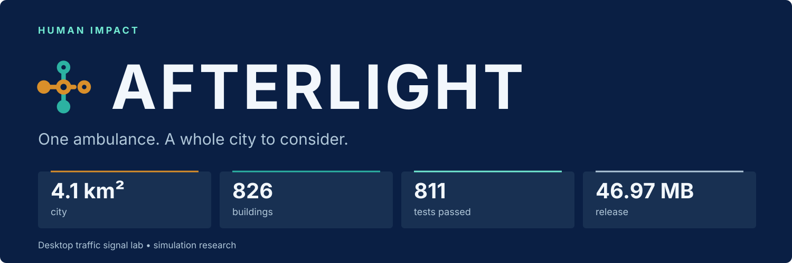
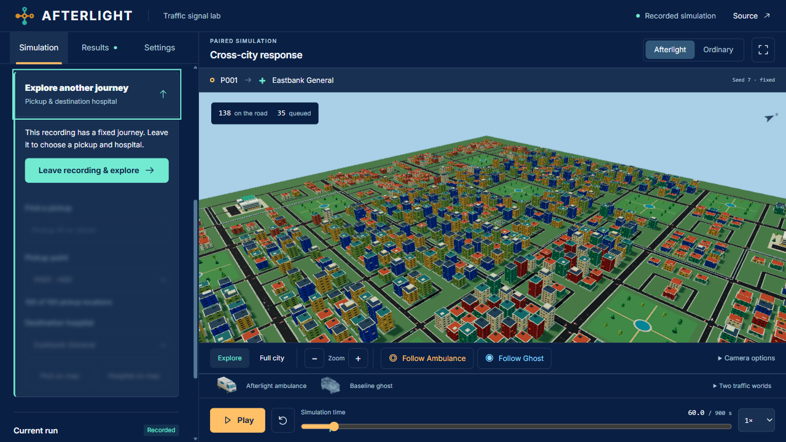
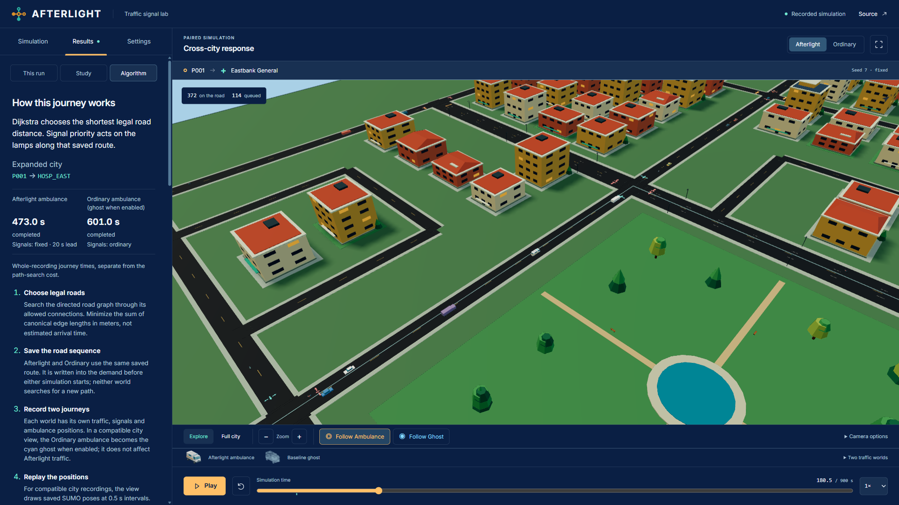
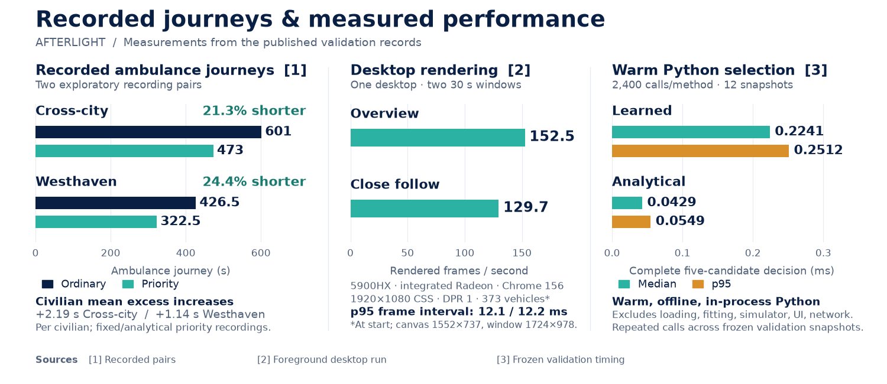
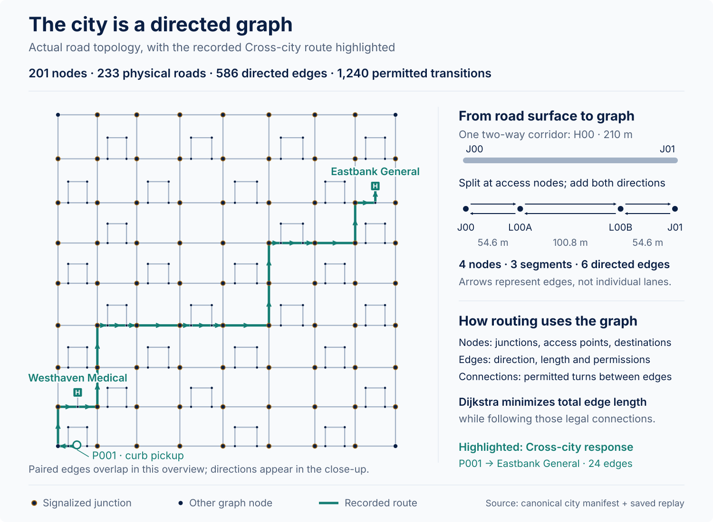
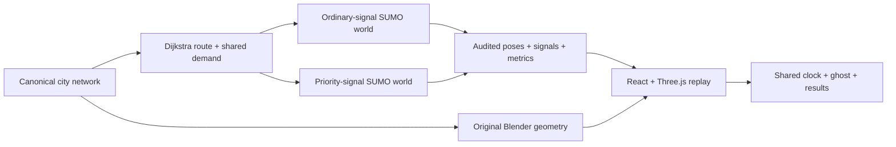
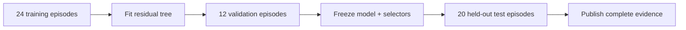

# AFTERLIGHT

**An AI-powered research solution for Human Impact — Healthcare, Education & Social Good.**

Accessible, responsible AI for emergency mobility, traffic education and citizen-service planning.



**FT-01 · Smart Traffic Signal Optimisation**<br>
**Team:** Crash Out · **Member:** Junaid Ahamed

**[Open AFTERLIGHT ↗](https://afterlight-gamma.vercel.app/)** · [81-second original-release demo](https://afterlight-gamma.vercel.app/media/afterlight-desktop-demo.mp4) · [Evidence](docs/BENCHMARK_PROTOCOL.md)

## Index

[01 · Impact](#01--impact) · [02 · Experience](#02--experience) · [03 · Benchmarks](#03--benchmarks) · [04 · How it works](#04--how-it-works) · [05 · AI](#05--ai--evidence) · [06 · Quality](#06--quality) · [07 · Run locally](#07--run-locally) · [08 · Project guide](#08--project-guide) · [09 · Credits](#09--credits)

## 01 · Impact

**The problem:** ambulance priority changes traffic across a city. Measuring only the ambulance misses everyone waiting behind it.

**The solution:** compare ordinary signals and ambulance priority under the same scheduled demand. Watch both journeys; measure ambulance time and civilian delay together.

- **Healthcare:** explore simulated ambulance access to two hospitals.
- **Education:** inspect signals, queues, routes and the algorithm behind each journey.
- **Social good:** make public-service tradeoffs visible and reproducible.

Research prototype; real-world deployment and safety certification are outside its scope. The hosted experience replays audited simulations.

## 02 · Experience


1. **Two traffic worlds.** Shared demand and route; independent signals, vehicles and queues.
2. **Follow either ambulance.** Solid priority ambulance + ordinary-world ghost, on one clock.
3. **Inspect every moment.** Pause, scrub, orbit and play up to **20×** speed.
4. **See through the city.** Street reveal enabled by default; red/blue roof lights.
5. **Start confidently.** Five-step onboarding, keyboard controls and reduced-motion support.
6. **Understand the route.** Results → Algorithm exposes exact road edges, Dijkstra and source links.


**4× original map area · 4.1004 km² · 81 primary intersections · 77 signal controllers**<br>
**826 buildings · 411 trees · 288 streetlights · 8 parks · 100 pickup anchors · 2 hospitals**

[City geometry](assets/map/README.md) · [Original Blender assets](assets/PROVENANCE.md)

<details>
<summary><strong>First response in three clicks + more screenshots</strong></summary>

1. Open **Cross-city response** or **Westhaven response**.
2. Press **Play**, then **Follow Ambulance** beside Zoom.
3. Select **Ordinary** or **Follow Ghost** to compare. Open **Results** for measurements.


**Explore another journey** exposes pickup and hospital controls. **Leave recording & explore** unlocks them and focuses search.





</details>

## 03 · Benchmarks



**128 s / 104 s saved in two recorded examples · 152.5 FPS overview · 0.2241 ms median learned selection**

<details>
<summary><strong>Exact benchmark values, hardware & measurement conditions</strong></summary>

### Recorded ambulance journeys

- **Cross-city: 128 s saved · 21.3% shorter.** **601 → 473 s** with fixed 20 s lead; civilian mean excess **+2.19 s/person**; **398/398** civilians finish in each world.
- **Westhaven: 104 s saved · 24.4% shorter.** **426.5 → 322.5 s** with analytical priority; civilian mean excess **+1.14 s/person**; **426/426** finish in each world.
- **Four published worlds:** zero collisions and teleports. **9,839 eligible stop-line crossings** presentation-audited; zero red/all-red or unresolved movements.

Two exploratory examples, recorded every **0.5 s** through **900 s**. These demonstrate fixed/analytical priority; the learned-selector evaluation is separate. [Recording measurements](docs/validation/expanded-city-recordings.json) · [Crossing audit and scope](docs/validation/expanded-city-presentation.json)

### Desktop rendering

- **152.5 FPS overview · 129.7 FPS close follow.** Frame-interval p95: **12.1 / 12.2 ms**.
- Ryzen 9 **5900HX**, integrated AMD Radeon, Chrome 156; **373 vehicles** at measurement start.
- Separate **30-second**, visible/focused windows; **1920×1080 CSS / DPR 1**, canvas **1552×737**; street reveal enabled.

Browser rendering cadence on one desktop. [Exact environment and samples](docs/validation/journey-algorithm-desktop-performance.json)

### AI selection & delivery

- **Learned selector:** **0.2241 ms median / 0.2512 ms p95**.
- **Analytical selector:** **0.0429 ms median / 0.0549 ms p95**.
- **2,400 decisions/method**, 12 validation observations, five candidates/decision. Warm Python timing excludes loading, training, simulation, browser and network. [Timing record](docs/validation/study-v4/selector-timing.json)
- **46.97 MB total · 63 files · under 50 MB**, including models, lossless recordings, evidence, font and walkthrough. [Release inventory](docs/validation/journey-algorithm-release.json)

</details>

## 04 · How it works

### The city as a road graph



**Nodes** mark intersections, access points and hospital destinations. **Directed edges** describe travel between them; **connections** define which turns are permitted. The 233 physical roads split at access points into **586 directed edges across 201 nodes**, with **1,240 permitted edge-to-edge transitions**. Pickup anchors attach to edges rather than adding graph nodes.

The highlighted **Cross-city response** follows the recorded **24-edge route from P001 to Eastbank General**. Dijkstra minimizes total edge length over permitted directed edge transitions. The 3D scene renders each physical road once; opposite travel directions belong to the graph.

[Canonical map and graph contract](assets/map/README.md) · [Routing implementation](sim/network.py) · [Regenerate this diagram](scripts/render_road_graph.py) with `python scripts/render_road_graph.py`.

### From graph to replay



**Routes:** permitted directed roads, minimum distance. **Priority:** minimum-green, yellow and all-red transitions. **Ghost:** ordinary-world recording, overlaid without affecting priority-world traffic.

**Stack:** React 19 · TypeScript · Three.js · Vite · Python · SUMO/TraCI · scikit-learn · Blender 5.2.2 LTS · Canva · Vercel.

[Architecture](docs/ARCHITECTURE.md) · [Signal scheduler](policies/scheduler.py) · [Blender pipeline](docs/BLENDER_PIPELINE.md)

## 05 · AI & evidence

The offline AI component adds a **learned residual tree** to an analytical cost estimate, then scores **five priority lead times**. Dijkstra handles routing; the learned model studies signal timing.



**11 tree nodes · depth 3 · 120 finite training labels · 140 test worlds audited**

**28 public proof files · 2.41 MB pack · 170.70 MB original JSON preserved · 40 paired comparison rows**

Policy performance is reported as paired objectives and uncertainty in the [complete study results](docs/validation/study-v4/report-checkpoint.json). [Model details](models/README.md) · [Protocol](docs/BENCHMARK_PROTOCOL.md) · [Per-case CSV](https://afterlight-gamma.vercel.app/study/paired-records.csv)

<details>
<summary><strong>Recompute the public proof with standard-library Python</strong></summary>

```sh
python scripts/verify_public_study.py --base-url https://afterlight-gamma.vercel.app/ --released-manifest-sha256 f5b3b10f59c4daf3b77aaa9aaec971d7b7f7ac85c95027021bbfaa305ae1aea9
```

Checks original hashes, world inventories, model choices, per-case outcomes and intervals. No SUMO, fitting, API key or private inputs required. [Verification guide](docs/STUDY_BROWSER_ACCEPTANCE.md)

</details>

## 06 · Quality

1. **811 executed tests passed:** **664 Python + 147 Node**; five explicit Python skips. **11 source stages**, including **two network conversions**. [Source checks](docs/validation/journey-algorithm-source-acceptance.json)
2. **200/200 pickup–hospital routes:** static directed connectivity validated. [Map qualification](docs/validation/expanded-network-qualification.json)
3. **18/18 paused camera pairs:** exact image matches across **two desktop profiles**. [Camera checks](docs/validation/journey-algorithm-camera.json)
4. **Two separate polish passes:** onboarding, playback, signal presentation, keyboard and graphics recovery. [Polish record](docs/validation/prehosting-two-polish-passes.json)
5. **Public browser acceptance:** both recordings, journey lock/unlock, cancellation, Algorithm, Study and reload. [Public checks](docs/validation/journey-algorithm-public-browser.json)
6. **63/63 hosted files:** published sizes and SHA-256 hashes match the accepted build. [Deployment checks](docs/validation/journey-algorithm-hosting.json)

## 07 · Run locally

**Desktop browser · Node ≥22.12 · npm**

```sh
git clone https://github.com/JunaidAhamed-7777/afterlight.git
cd afterlight
npm --prefix web ci
npm --prefix web run dev
```

Open the localhost URL printed by Vite. The viewer needs **no API key, Python, SUMO or environment file**.

```sh
npm --prefix web test       # Frontend contracts
npm --prefix web run build  # TypeScript + production build
```

For local simulation/generation, follow the [loopback API setup](api/README.md) and [simulation guide](sim/README.md). Generation completes before recorded playback.

## 08 · Project guide

- **Viewer:** [Controls, setup and browser checks](web/README.md)
- **Engine:** [Simulation](sim/README.md) · [Policies](policies/scheduler.py) · [Local API](api/README.md)
- **AI:** [Models](models/README.md) · [Evaluation](evaluation/README.md) · [Benchmark protocol](docs/BENCHMARK_PROTOCOL.md)
- **Design:** [Visual system](DESIGN.md) · [Editable Canva identity](https://canva.link/plj2l49fb5akdcu) · [Asset provenance](assets/PROVENANCE.md)
- **Release:** [Accepted inventory](docs/validation/journey-algorithm-release.json) · [Roadmap](docs/ROADMAP.md) · [Handoff](HANDOFF.md) · [Compiled preview](preview/README.md)

## 09 · Credits

**Team Crash Out · Junaid Ahamed**

**AI development disclosure:** ChatGPT/Codex assisted with source code, procedural Blender assets, tests, analysis tooling and documentation. Blender MCP supported model authoring; Canva supported the identity. Measurements and screenshots come from executed runs.

Original city and vehicle assets; self-hosted Inter under the OFL. [Asset credits](assets/PROVENANCE.md) · [Third-party notices](https://afterlight-gamma.vercel.app/THIRD_PARTY_NOTICES.txt)
