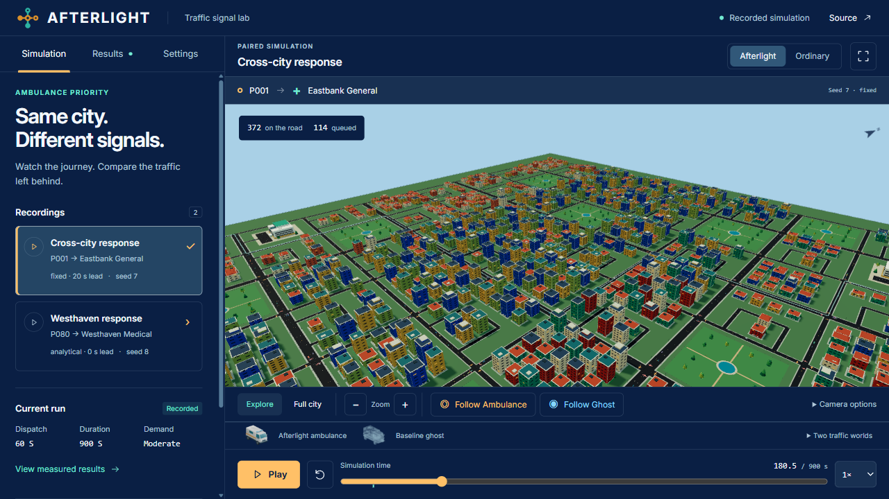
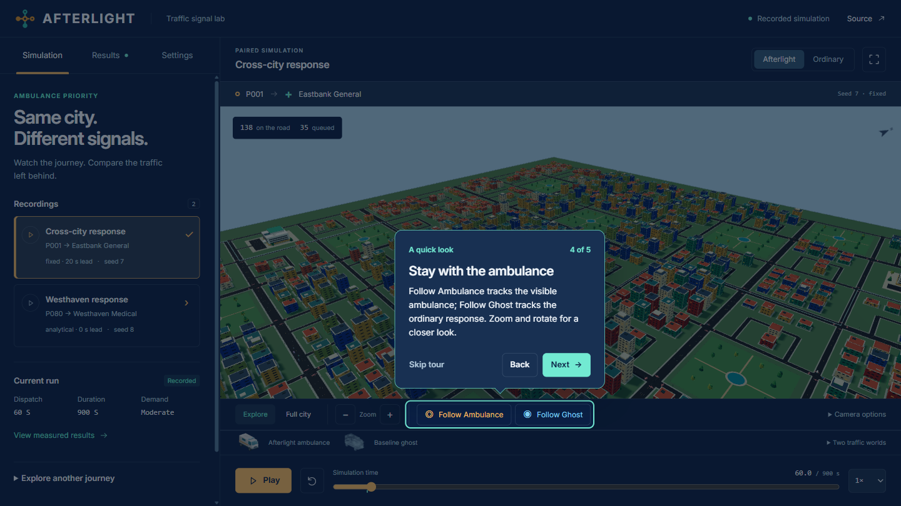
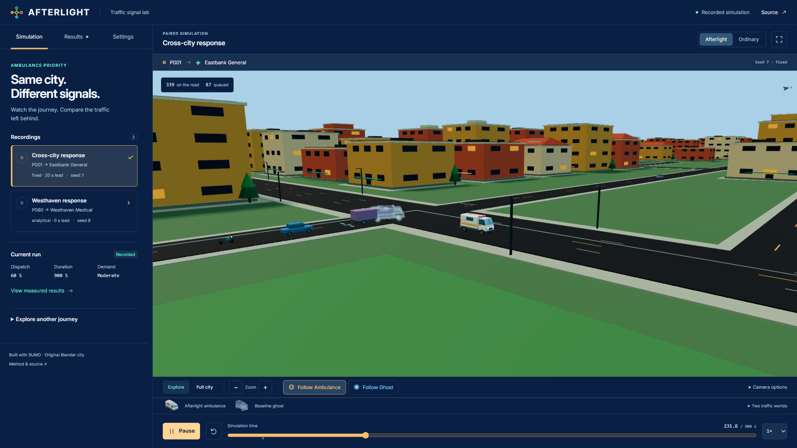
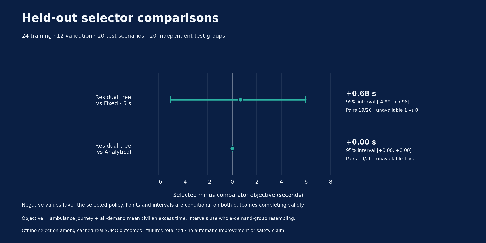

# AFTERLIGHT

A desktop traffic signal lab. Follow an ambulance through a miniature city, inspect the ordinary-signal response, and measure the traffic cost of giving it priority.

[Open the lab](https://afterlight-gamma.vercel.app/) · [Watch the 81-second walkthrough](https://afterlight-gamma.vercel.app/media/afterlight-desktop-demo.mp4) · [Experiment and measurements](docs/BENCHMARK_PROTOCOL.md)



## Try a response

1. Open **Cross-city response** or **Westhaven response** and press **Play**.
2. Select **Follow Ambulance**, beside Zoom. Orbit or zoom closer while it tracks the vehicle.
3. Switch to **Ordinary** to inspect that world's traffic and signals. **Follow Ghost** puts its translucent ambulance over the Afterlight scene on the same clock.
4. Pause, scrub, or use **10× / 20×** to explore the journey. Speed changes playback for both worlds together.
5. Open **Results → This run** for the recording's outcomes, or **Study** for the separate held-out experiment.

A five-step first-visit guide introduces these controls. Reopen it from Settings. The left pane scrolls; the map and playback stay on screen. Desktop, keyboard and mouse are the intended experience.



## The city and its traffic

The original Blender city covers **4.1004 km²**, exactly four times the earlier map's area. It has 81 primary intersections, 77 signal controllers, 826 buildings, eight parks, 100 pickup anchors and hospitals in two diagonal quadrants. Cars, trucks and bikes follow genuine SUMO recordings. Movement arrows show the recorded signals.

Both traffic worlds use the same external demand and routes. Each has its own vehicles, queues and signal decisions. The ghost comes from the ordinary world and never affects Afterlight traffic. Its overlap with a visible vehicle is a comparison between separate worlds.

The roof lights alternate red and blue during playback. Reduced motion keeps them steady and disables continuous camera following. The model thumbnails in the legend are renders of the original ambulance.



Logarithmic depth and separated road/plaza surfaces correct the camera-dependent striping. Fourteen paused camera-repeat pairs at two desktop resolutions matched exactly; independent screenshot review found no visible depth conflicts. [Camera and post-identity acceptance](docs/validation/postbrand-desktop-acceptance.json)

## What the recordings show

These are **two exploratory examples**, each retaining every 0.5-second simulation step through 900 seconds:

- **Cross-city, fixed 20 s lead:** ambulance journey **601 → 473 s**, saving 128 s. Mean civilian excess travel time increases **2.19 s**. All 398 civilians finish in each world.
- **Westhaven, analytical lead:** ambulance journey **426.5 → 322.5 s**, saving 104 s. Mean civilian excess increases **1.14 s**. All 426 civilians finish in each world.

All four worlds report zero collisions and teleports. A separate presentation audit found no red/all-red or unresolved movements among 9,839 eligible stop-line crossings. These checks apply to the published recordings; the two examples do not establish held-out model performance. [Recording evidence](docs/validation/expanded-city-recordings.json) · [Presentation audit](docs/validation/expanded-city-presentation.json)

## The learned selector did not improve the held-out result

The frozen study uses **24 training, 12 validation and 20 test episodes**, with seven policy worlds per episode. Heavy demand and one ordered route family are held out. The predeclared residual tree has 11 nodes, depth 3 and 120 finite candidate labels from the 24 training groups. Validation chooses the fixed comparator's 5-second lead.

The single test attempt retains **all 140 worlds: 134 completed and six collision-invalid**. Against fixed 5 s, the learned selection has **one failure versus zero**. Among the 19 pairs with valid objectives in both choices, mean objective difference is **+0.681 s**, with a 95% group-bootstrap interval of **−4.993 to +5.978 s**. Lower is better. The interval includes zero.

The learned and analytical selectors choose the **same action in all 20 test episodes**. There is no demonstrated learned benefit, and the model is not promoted. Selection operates offline over five cached candidates; the hosted site replays evidence.



The objective adds ambulance journey time to mean civilian excess travel time over all scheduled civilian demand, with weight 1. Failures stay in the counts; unavailable outcomes never become zero. A retained pre-fit metadata failure led to an explicitly frozen analysis correction before the model fit and test release. Original physics, data and failed evidence remain intact. [Protocol](docs/BENCHMARK_PROTOCOL.md) · [Analysis amendment](docs/ANALYSIS_AMENDMENT.md) · [Per-case results](https://afterlight-gamma.vercel.app/study/paired-records.csv)

## Measured on the desktop

The measured identity build recorded **161.8 FPS overview / 127.7 FPS close follow** in separate 30-second foreground windows. The profile used a Ryzen 9 5900HX, integrated AMD Radeon graphics, Chrome 156, a 1920×1080 CSS viewport at DPR 1 and 373 vehicles at the chosen start frame. The native window was 1724×978; the canvas buffer was 1552×737. These measurements describe browser rendering cadence on this machine. [Measurements, method and retained earlier attempts](docs/validation/final-desktop-performance.json)

Complete warm Python selection across five candidates measured **0.2241 ms median / 0.2512 ms p95** for the learned method, versus **0.0429 / 0.0549 ms** analytical. That is 2,400 repeated decisions per method across 12 validation observations, excluding I/O, startup, simulation, browser and network. [Original timing samples](docs/validation/study-v4/selector-timing.json)

The complete 63-file release is **46.96 MB**, including original models, lossless recordings, proof, font and the 6.67 MB walkthrough. The city GLB is 14.38 MB; the two compressed recordings total 13.30 MB. Loading progress, cancellation, graphics recovery and recording retries are part of the viewer. [Exact release inventory](docs/validation/final-production-release.json)

## Verify the experiment

The public proof pack contains 28 files totaling 2,405,037 bytes, including four lossless grids representing **170,697,107 bytes of complete original JSON**, the model, selectors, original report, 40 comparison rows and amendment/release evidence.

Recompute it with Python's standard library, without SUMO, model fitting or private inputs:

```sh
python scripts/verify_public_study.py --base-url https://afterlight-gamma.vercel.app/ --released-manifest-sha256 f5b3b10f59c4daf3b77aaa9aaec971d7b7f7ac85c95027021bbfaa305ae1aea9
```

The verifier checks original bytes, full world inventories, frozen choices, failures, per-case rows and confidence intervals. [Public verification instructions](docs/STUDY_BROWSER_ACCEPTANCE.md) · [Publication record](docs/validation/study-v4/publication.json)

The final source run passed **664 Python and 139 Node tests**, with five explicit Python skips. Both fixture and city network conversions passed. All 63 public files match the frozen build; browser playback, seeking and the released Study were checked on the hosted site. [Source checks and skip reasons](docs/validation/final-source-acceptance.json) · [Public deployment checks](docs/validation/production-hosting-final-acceptance.json)

## Run locally

Use **Node ≥22.12** and the committed lockfile:

```sh
npm --prefix web ci
npm --prefix web run dev
```

The static viewer needs no Python, SUMO, API key or environment file. For simulation or new recordings, follow the [local API instructions](api/README.md). See [viewer controls and tests](web/README.md), [architecture](docs/ARCHITECTURE.md), [source-bound preview](preview/README.md) and [current handoff](HANDOFF.md).

## Assets, identity and attribution

The current city and model work used Blender 5.2.2 LTS through the existing Blender MCP bridge. Source scenes, generators and export records are retained. [Asset provenance](assets/PROVENANCE.md) · [Blender pipeline](docs/BLENDER_PIPELINE.md)

The [editable Canva identity guide](https://canva.link/plj2l49fb5akdcu) supplied the navy, amber, teal and Inter direction. The frontend implements the reviewed signal mark as SVG and self-hosts Inter under its full OFL license. [Design decisions](DESIGN.md) · [Runtime third-party notices](https://afterlight-gamma.vercel.app/THIRD_PARTY_NOTICES.txt)

ChatGPT/Codex assisted with source, tests, procedural Blender work, analysis tooling and documentation. Measurements and screenshots come from executed local runs. AFTERLIGHT is simulation research; it has no real-world traffic-control or safety certification.
