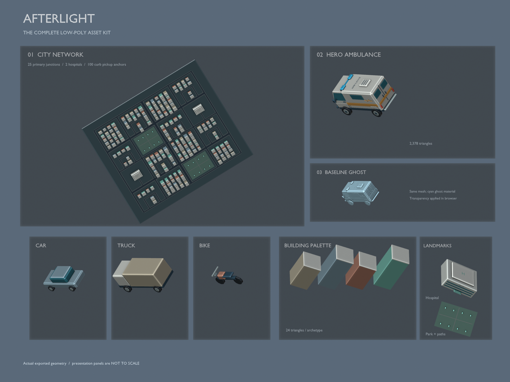

# Afterlight — original low-poly asset pack

Authored in Blender 4.3.2 through the already-installed pinned Blender MCP socket bridge in the cloud desktop. No imported art, textures, commercial assets, external generation services, or prior car-film assets are used.

## Deliverables

- `exports/ambulance.glb`: detailed stylized hero rescue van.
- `exports/{car,truck,bike}.glb`: inexpensive recognizable civilian archetypes.
- `exports/building_*.glb`: four shared two-material cuboid building modules.
- `exports/ghost_material.json`: cyan translucent baseline recipe reusing ambulance geometry; no separate physics body or fictitious lag.
- `exports/city_static.glb`: batched city surface and buildings, generated from the canonical street manifest.
- `exports/city_instances.json`: semantic building transforms, pickup anchors, hospital destinations. Coordinates remain source XY ground/Z-up metres; convert at import.
- `map/city_manifest.json`: authoritative graph and geometry, with 25 primary intersections, two hospitals, and 100 curbside pickup markers. Includes extra unsignalized service/access/bend nodes, not 57 primary intersections.
- `.blend` authoring scenes and `src/` deterministic construction scripts.
- `previews/`: authoring stills, not performance or simulation evidence.
- `qa/`: independently measured GLB validation, triangle counts and export bounds.

## Coordinates

Source Blender +Y is vehicle forward; standard glTF export maps this to -Z, with +Y up. Vehicle origins are ground-centered. A SUMO front-bumper coordinate must be shifted backward by half the actual vehicle length to place the model center. Roofs/front view visually verify orientation; runtime cardinal-heading fixture remains necessary.

Use canonical manifest `roads`, not both directed edges, for road surfaces. Pickup dots are pedestrian curb anchors outside asphalt, not vehicle centroids. Hospital arrival ends the current planned trip; continuous turnaround is not yet implemented.

## Runtime loading

`city_static.glb` already includes buildings. Do not additionally instantiate `city_instances.json` building rows on top of it. An optimized alternate path can use shared archetypes but must omit baked building geometry. Static batching cuts draw calls; it does not lower triangle counts. Vehicles should be instanced per geometry/material, with distant LOD where needed. Textures are not required.

The ghost must follow a synchronized recorded baseline trajectory. Its material is presentation only. It cannot honestly display baseline queues on the optimized world's traffic: use a labeled overlay and optional separate baseline view. Disable ghost picking and shadows, retain depth testing, disable depth writes, and keep bloom optional. Blender preview dithering is not the browser alpha blend implementation.

## Provenance and scope

All geometry is newly authored procedurally for this project. Branding is fictitious; the amber pulse motif is original and is not the protected Red Cross emblem. Blender and the existing MCP addon are tools, not copied application assets. The addon itself is intentionally not vendored. No third-party artwork attribution is required for these newly created meshes. The repository owner should choose an explicit project distribution license; this pack does not silently license third-party dependencies.

Asset-stage only: no real traffic simulation, benchmark results, measured browser FPS, or production dispatch capability is claimed. See the repository `docs/` for product requirements and benchmark protocol.

## Reproduction

Blender 4.3.2 is the tested authoring version. In a new empty Blender GUI session, run the scripts in order: `src/generate_assets.py`, `src/finish_vehicle_qa.py`, then `src/generate_city.py`, and finally `src/polish_city_parks.py` once. Each script resolves its own pack root from `__file__`. When executing a source file through an MCP execute-code command, supply `__file__` in the execution namespace, e.g. `exec(compile(path.read_text(), str(path), 'exec'), {'__file__': str(path)})`. The separately installed Blender MCP bridge is not vendored. Preserve existing projects: the first generator clears the current scene.

Run `python map/generate_city.py` and `python map/validate_city.py` for the standard-library graph checks. Run `python src/package_manifest.py` to refresh file sizes/hashes after regeneration. No credentials or external asset services are required.

## Verified asset-stage results

Nine GLBs total **1,268,584 bytes (1.21 MiB)**, with no texture files. The hero ambulance has **2,378 triangles**; car **412**, truck **368**, bike **196**; each building module **24**. The final city adds inexpensive park trees and paths; the final city is **14,552 triangles / 15 material batches**. See `asset_manifest.json` for final geometry and hashes. All nine GLBs pass independent Khronos validation (zero errors/warnings); browser HTTP loading and GLTFLoader parsing pass. Cloud Chrome reports WebGL disabled, so actual browser drawing/frame-time/ghost compositing remains unverified; no FPS claim. Native Blender still previews were inspected.

City geometry has a nonzero GLB root translation inherited from static batching. Preserve the node's transform when importing; do not reset it to zero. The manifest remains canonical XY/Z-up meters.

## Supplemental asset overview

This supplemental Blender contact sheet displays the actual exported city, ambulance, civilian fleet, building palette and landmark geometry. Panels are deliberately **not to scale**; the cyan ghost panel is an opaque presentation treatment, not proof of browser transparency or simulation. Regenerate it with `src/render_asset_overview.py` in Blender, using the same `__file__` convention above. It imports existing GLBs and does not modify their files.

`DELIVERY_FILES.json` is the immutable snapshot manifest for the original 35-file ZIP, not an evergreen checksum list for later repository revisions. This overview image/script and this README addition were added afterward; the original manifest and ZIP remain unchanged.

## Interactive city enhancement

The application now uses `exports/city_enhanced.glb`, an additional authored
4,439,048-byte 3D city. The original nine-GLB pack above is unchanged and its
validation applies only to that original delivery. Editable enhancement source
is `afterlight_city_enhanced.blend`; its deterministic Blender generator is
`src/enhance_city.py`. The companion enhanced manifest binds source hashes,
187 building IDs, real geometry bounds and revision metadata. V3 adds shallow
modeled facades, chamfered rooftop service volumes and hospital entry/roof
structure; it does not change canonical roads or tiny civilian vehicle assets.
See [camera and geometry contract](../docs/CAMERA_AND_3D_MAP.md). V3 has build/export
evidence only until pinned Omen acceptance; no new render performance is claimed.
